# 《奇妙小镇》美术风格高保真视觉提案

本目录仅用于确定整体美术方向，不修改现有玩法和程序。所有画面均为原创视觉方向样稿，不含系统 Emoji；它们不是最终上线切图，风格确认后仍需统一角色设定、透视、字号、状态规范并拆分为正式游戏资产。

## 方案 A V2：中等精致度二维卡通（当前推荐）

在原方案 A 的基础上降低约 30%–40% 的细节与材质层次，保留清晰描边、明快平面色块和明确的交互轮廓。角色、建筑与商品采用更大的形状和更少的阴影层，便于后续覆盖 14 个子游戏，同时仍保持完整的卡通游戏感。

### 当前整套样稿

封面与资产体系均以一名儿童和一名成年家长为核心角色。狐狸不再作为主角，可在后续作为小镇 NPC 使用。

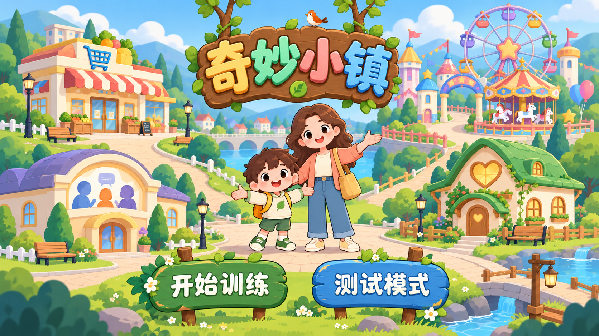

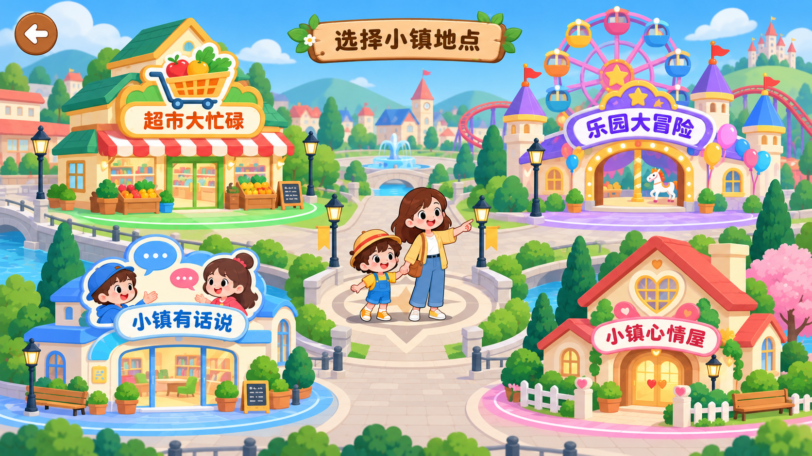

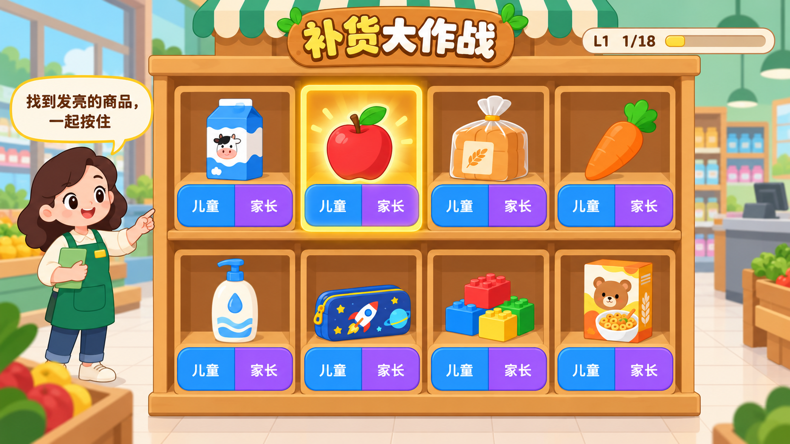

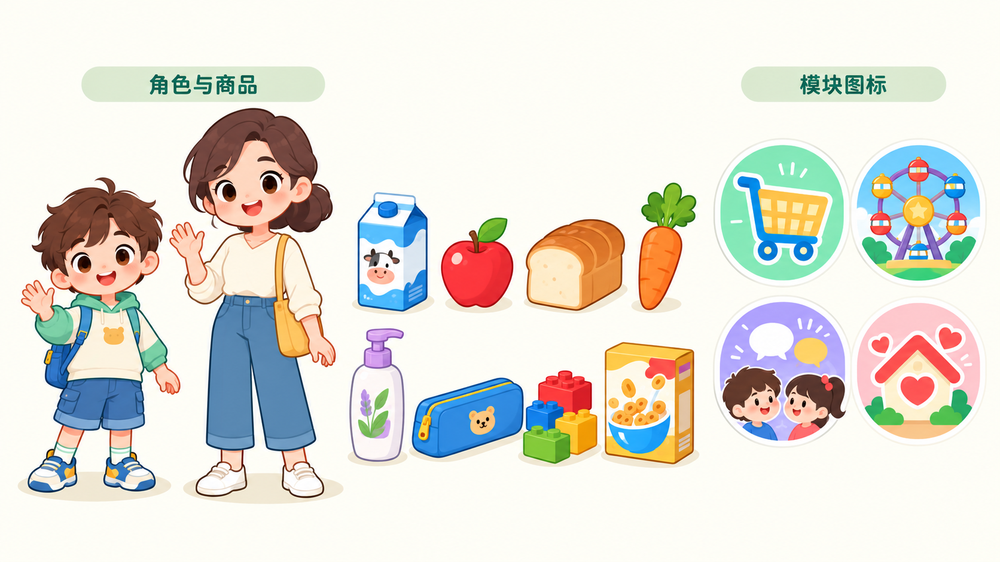

### 原方案 A（保留用于对照）

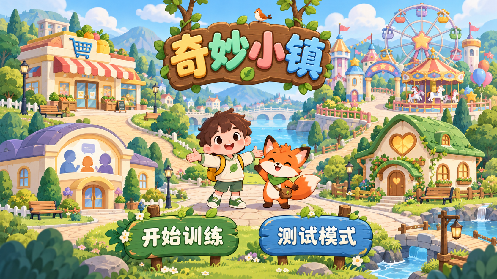

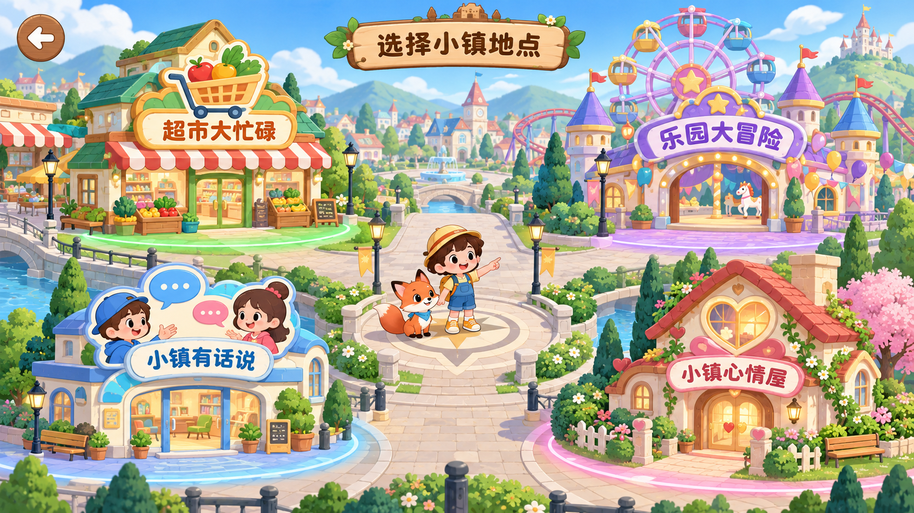

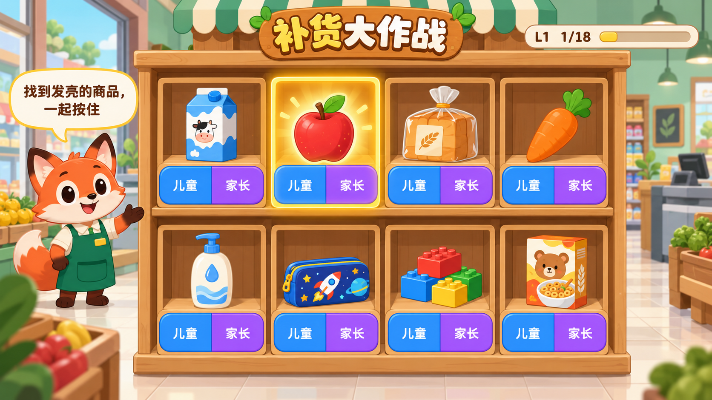

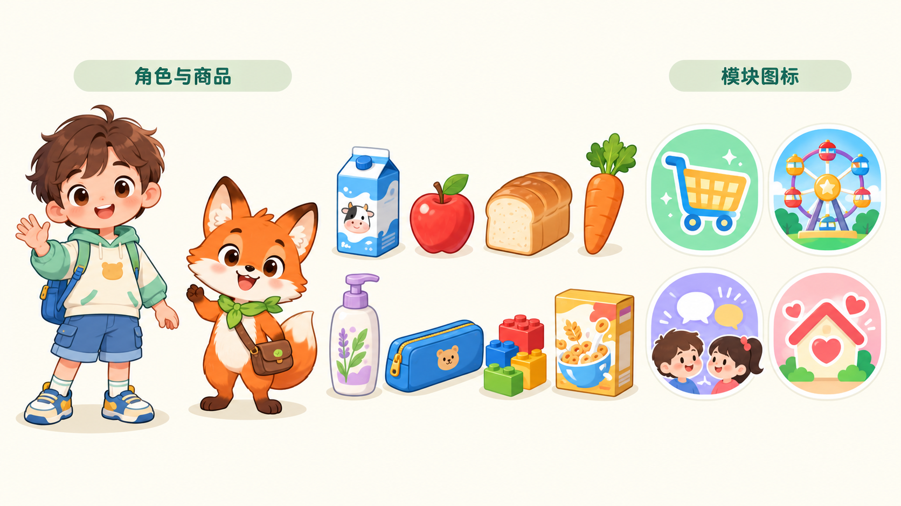

## 方案 B：柔和立体质感二维卡通

圆润造型、弱描边、柔和体积光、纸塑/织物/水粉材质层次。整体更温柔、更具故事书和手作质感；视觉刺激更低。

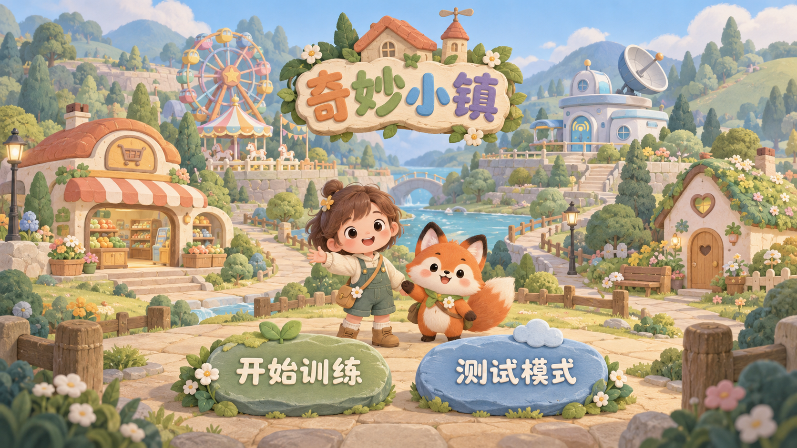

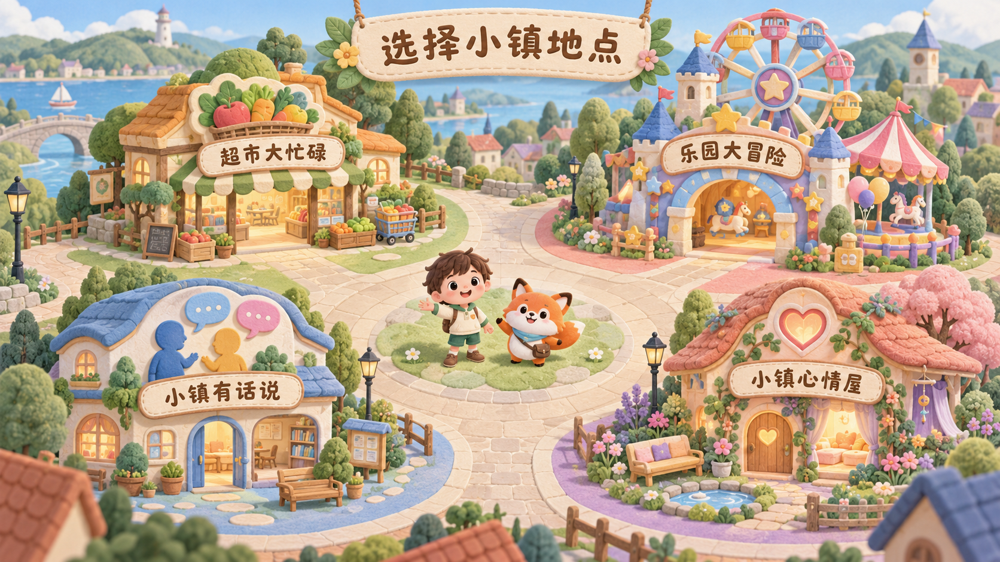

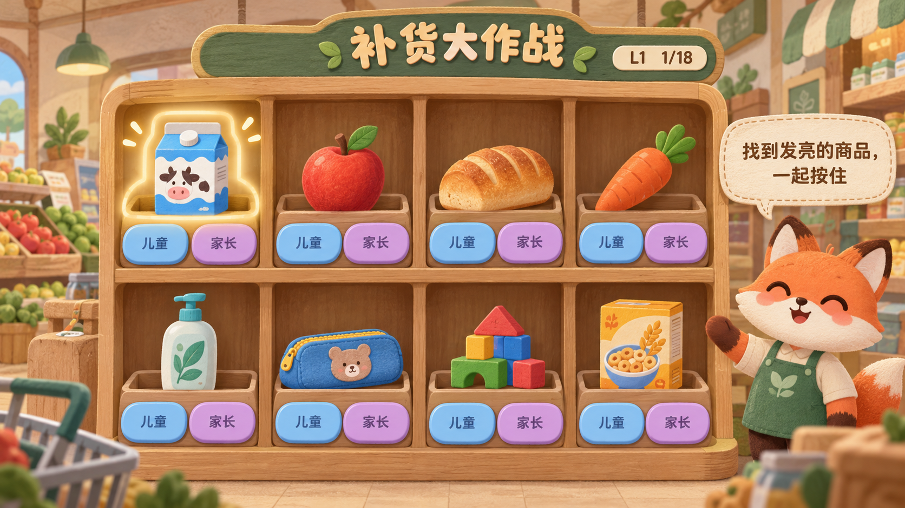

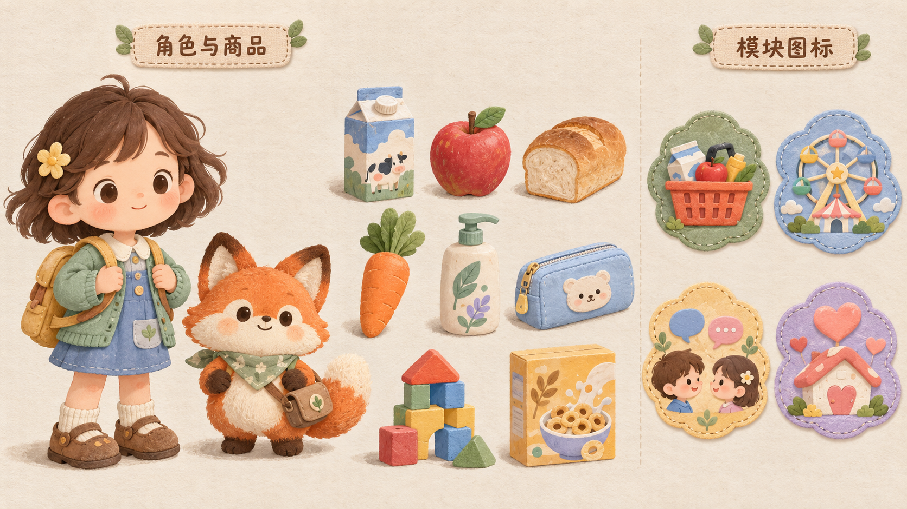

## 共同约束

- 横屏平板优先，核心触摸区保持大尺寸和稳定位置。
- 四模块共享同一小镇、角色、建筑比例和图标语言。
- 高亮只服务于当前任务，避免闪烁、粒子堆叠和高饱和背景干扰。
- 儿童与家长身份色在全游戏中固定，正式落地时还会增加形状/纹理冗余，避免仅靠颜色区分。
- 风格确认后，正式资产将按角色、建筑、商品、图标、背景和交互状态分别制作与验收。
